# Math Boxes — описание игры

> Внутренний документ. Лежит в `_docs/` и **не попадает в сборку**: Vite копирует
> в `docs/` только содержимое `public/`, а Capacitor упаковывает в APK/AAB
> каталог `webDir: docs`. Ни в PWA, ни в Android-бандл эта папка не входит.

| | |
|---|---|
| Пакет | `com.thelightcome.mathboxes` |
| Версия Android | `versionCode 5`, `versionName 5.0` |
| Стек | Vue 3 (Composition API) + Pinia + vue-i18n, Capacitor 8, Vite 5 |
| Платформы | Android (Google Play) и PWA из `docs/` |
| Языки | ru, en, kk, de, es, fr |
| Ориентация | Портрет, вёрстка от 390×844 |

---

## 1. Суть

Игрок видит уравнение, где одно число заменено пустым гнездом, и выбирает
нужную «коробку» из четырёх вариантов. Коробка прилетает в гнездо, счёт растёт.

**У каждого уравнения свой таймер.** Новое уравнение — новые секунды. Не успел
или ошибся — минус жизнь. Четыре жизни, и партия заканчивается: длительность не
выбирается и не задаётся заранее, её определяет то, как долго игрок держится.

Сложность при этом подстраивается под игрока и не стоит на месте: 13 уровней и
овертайм на последнем — см. раздел 4.

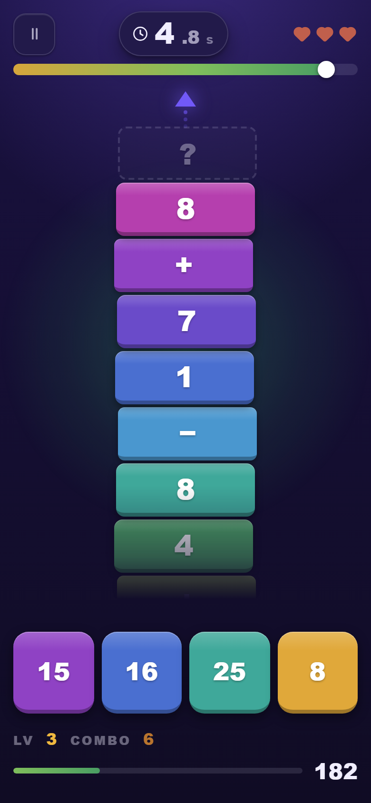

---

## 2. Один экран до игры

Раньше между запуском приложения и первым примером стояли два экрана решений:
главная с четырьмя карточками режимов и экран настройки с семью операциями,
длительностью и рекордом. Теперь всё помещается на одну страницу, и **до первого
примера ровно одно нажатие**.

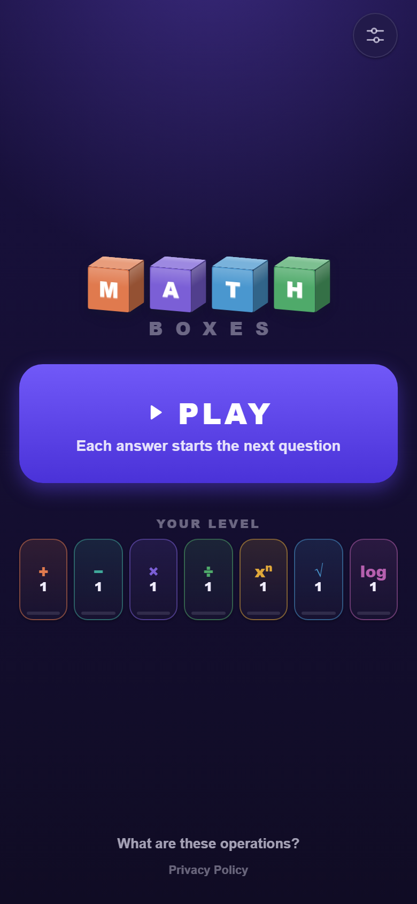

Кнопка «Играть» — единственный крупный объект на экране. Режим один, выбирать
нечего: под кнопкой стоит полоса уровней по семи операциям, и это показания, а не
переключатель.

| Что | Слот рекорда |
|---|---|
| Единственный режим — цепочка | 10 |

**Режимов было четыре, стало ноль.** Сначала ушли «Свой» и «Задание дня», потом
«Микс», следом «Одна». Каждый из них есть у любого тренажёра устного счёта и
ничем не выделял игру; цепочка не есть ни у кого. Игра с одним режимом проще
объясняется, проще продаётся и проще доводится до ума.

Цена решения измерена: цепочка может предложить только те операции, которые
законны от текущего числа — корень требует полного квадрата, логарифм точной
степени, деление делителей. При полностью открытой лестнице получается 49 %
сложения против 3–4 % на степень, корень и логарифм. Игра стала преимущественно
про сложение и вычитание, а редкие операции — наградой за долгую игру, а не
частью каждой партии.

### Режим «Цепь»

`chainStep()` в `src/utils/mathEngine.ts`. Ответ на уравнение становится первым
операндом следующего: `9 +3 → 12 ×3 → 36 −6 → 30`. Один инвариант держит всё:
**`a` — где ты стоишь, `result` — куда идёшь**, поэтому в цепочке всегда скрыт
результат, а не операнд.

**Что видно на экране.** Башня, сложенная снизу вверх, и **каждый операнд и
каждая операция — отдельный блок**. `13` `+` `4` — это три блока один на другом,
а над ними пустой контур: место, куда встанет ответ. Плитки одного размера, все
до одной: операция занимает такой же ряд, как число, потому что в цепочке она
такой же шаг, а не подпись к нему.


**Результат — это фундамент следующего выражения.** Ответ встаёт в пустой контур
наверху, и на него тут же ложатся ещё два блока: операция и второй операнд, а над
ними снова пустой контур. Поэтому ни одно число в башне не написано дважды:
`13 + 4 = 17`, `17 + 2 = 19` — семнадцать стоит в кладке один раз и работает
сразу на два выражения.

**Промах роняет башню.** Верное число всё равно встаёт наверх — красным, а не
зелёным, — и его дают прочитать; через треть секунды кладка складывается и
улетает, блок за блоком, начиная с верхнего. Новая башня закладывается **с того
же верного числа**: цепочка в движке продолжается от него, поэтому высота на
экране — это ровно текущая серия верных ответов, и ни один блок в ней не врёт.

**Серия горит.** Пока игрок не ошибается, за башней разгорается свечение,
которое растёт вместе с комбо и гаснет с первой ошибкой. Счётчик внизу называет
число, свечение говорит, каково это.

**Как это устроено.** Кладка плоская: прямоугольник, скруглённые углы и одна
тёмная полоса по низу — этого хватает, чтобы блок читался лежащим на блоке.
Голова башни стоит на месте, а стек растёт вниз и уходит под нижний край, где
его гасит маска: камера остаётся у того блока, который игрок сейчас кладёт, —
так это и работает в играх про башни. Позиция каждого блока живёт в переменной
`--y`, а не в самом `transform`, поэтому падение может начаться оттуда, где блок
стоял, без пересчёта в JS.

Корень и логарифм не создают здесь проблемы, из-за которой прежнюю строчную
запись приходилось разрывать: `√` и `log₂` — это блок операции, который несёт
свой операнд в себе, поэтому под ним просто нет второго числа.

**Сложное здесь — не сгенерировать шаг, а сгенерировать шаг, который можно
продолжить.** Цепочка умножений выходит за читаемый диапазон за четыре шага, а
цепочка делений умирает, как только значение оказывается простым. Поэтому операнд
не берётся случайно, а **выводится** из текущего значения: `÷` предлагает только
делители, `√` — только если число полный квадрат, `log` — только если это точная
степень основания. Выбор между возможными ходами взвешен к середине диапазона:
иначе `+` и `×` загоняют значение в потолок, и остаются только `−` и `÷`.

Три решения, найденные по замерам:

- **аддитивный шаг ограничен отдельно** от потолка тира — иначе получаются шаги
  вида `9428 + 9426`: не более сложный вопрос, а тот же вопрос с бо́льшим числом
  переносов;
- **корень, степень и логарифм получают подготовку** — генератор специально
  подбирает `+b` или `×b`, попадающий ровно в квадрат или в степень основания.
  Без этого `√` встречался в 24 % партий, которые его уже открыли;
- **значение выше потолка не рвёт цепочку.** Тир может упасть после ошибок, и
  число, законное на 9-м тире, оказывается выше потолка 6-го. Вместо перезапуска
  разрешается любой ход, который уменьшает значение, и цепочка сама возвращается
  в диапазон. Это убрало последние 2.3 % разрывов.

Ошибка цепочку не портит: в гнездо всё равно встаёт **верное** число, и
следующее уравнение считается от него.

**Проверено:** 28 756 шагов в 4000 партиях с ответами верно/неверно/просрочка —
первый операнд всегда равен результату предыдущего уравнения, **0 разрывов**, во
всех вопросах скрыт результат. Плюс 416 000 шагов генератора по 8 наборам
операций и 13 тирам: валидное уравнение, ровно один решающий вариант из четырёх,
результат в пределах потолка. Баланс партии от режима не зависит: медианы
39 / 63 / 106 / 137 с против 38 / 64 / 107 / 139 с у обычных уравнений.

Описания всех семи операций собраны в один справочный лист по тихой ссылке
внизу главной: контент, который читают один раз, не заслуживает семи входов.

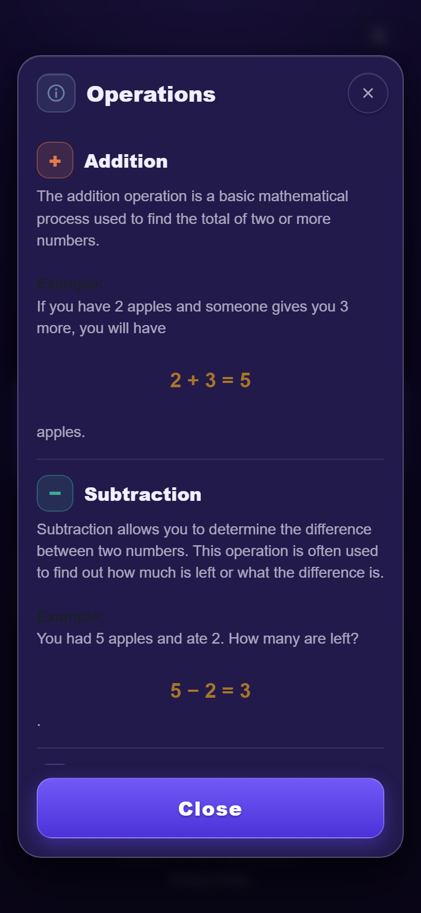

**«Играть снова» на финальном экране** перезапускает партию на месте, не
возвращая в меню: страница перемонтируется с новой сессией.

---

## 3. Генератор задач

`src/utils/mathEngine.ts`

Задача хранится **структурой**, а не строкой:

```ts
{ op, a, b, result, blank, answer, options, tier }
```

Ответ проверяется арифметикой через единственную функцию `verify()`. Отрисовка
никак не влияет на то, что считается верным — прежняя версия парсила строку
уравнения, и это было источником ошибок.

**Гарантия единственного ответа.** Каждый дистрактор прогоняется через
`isCorrectAnswer()` и отбрасывается, если тоже решает уравнение. Исключены
случаи `0 × b`, `1^n`, деление на ноль — они давали несколько верных вариантов.

**Правдоподобные дистракторы.** Не случайный шум, а типичные ошибки:

- перепутанная операция (`2^3 → 6`, `a+b` вместо `a×b`);
- ±1, ±2, ±10, ±100;
- перестановка последних цифр;
- половина/удвоение;
- для операндов — другие числа, которые видно на экране.

С 5-го тира ближние варианты идут первыми — отсеять их на глаз становится
труднее.

**Позиция пропуска** зависит от тира: новичку в 85 % случаев скрывается
результат, дальше подключаются операнды.

**Проверено:** 280 000 сгенерированных задач по всем операциям и тирам — валидное
уравнение, ровно один решающий вариант из четырёх, никаких отрицательных или
дробных опций, ровно одно пустое гнездо.

---

## 4. Адаптивная сложность

`src/composables/useMathSession.ts`

Задача — не «сделать сложно», а не дать заскучать в обе стороны: игрок не должен
проигрывать раньше, чем игра успела начаться, и не должен долго решать одно и то
же. Обе крайности меряются и обе настраивались по замерам.

**16 тиров (0–15)** с отдельными таблицами диапазонов на каждую операцию: от
`3 + 4` до трёхзначных на двузначные, от `2²` до `200²` и `25³`, от `log₂8` до
логарифмов по основанию 30.

Нижние три тира добавлены отдельно и намеренно крошечные. Лестница открывалась на
`7 + 9` и к пятому вопросу выходила на двузначные суммы — это не разгон, это
холодный старт. Сейчас в первых пяти вопросах числа не больше десяти, и это
только сложение и вычитание. Верх лестницы не тронут.

| Вопрос | Было | Стало |
|---|---|---|
| 1–5 | до 100, уже с `×` и `÷` | до 10, только `+` и `−` |
| ~9 | степени и корни | появляется `×` |
| ~13 | пятизначные | появляется `÷` |

**Один уровень на партию, а не на операцию.** В миксе из семи операций каждая
получала два-три вопроса за партию, и сложность физически не успевала вырасти.
Личный уровень по операции остался: он решает, с какого тира партия *стартует*
(на один ниже личного максимума), и записывается в конце.

| Событие | Прогресс тира |
|---|---|
| Верно, быстрее 40 % отведённого времени | +0.60 × темп |
| Верно | +0.45 × темп |
| Верно, но на последних 30 % времени | +0.30 × темп |
| Ошибка или просрочка | −0.55 |

Прогресс ≥ 1 — тир +1 (сбрасывается в 0.15), прогресс < 0 — тир −1 (0.55). Пол
поднимается вместе с пиком, поэтому серия ошибок не отбрасывает продвинутого
игрока к однозначным числам.

### Разгон партии

Партия всегда открывается на однозначных примерах и только на сложении и
вычитании — независимо от того, что записано в профиле. Потолок тира растёт по
номеру отвеченного вопроса:

| Вопрос | 1–3 | 4–5 | 6–7 | 8 | 9 | дальше |
|---|---|---|---|---|---|---|
| Потолок тира | 0 | 1 | 2 | 3 | 4 | +1 за вопрос, пока не догонит заработанный |

Так было не всегда. Стартовый тир брался как «личный максимум минус один», и у
любого, кто хоть куда-то дошёл, игра открывалась трёхзначным сложением — это
пришло из реальной партии, а не из замера. Теперь профиль решает, **куда партия
придёт**, а не с чего начнётся: стартовый тир — половина личного максимума, и до
него ещё нужно доехать по лестнице разгона.

Потолок поднимается по одному тиру за вопрос и после списка — иначе на девятом
вопросе были двузначные числа, а на десятом сразу трёхзначные.

**Операции подчиняются тому же потолку.** Иначе вернувшийся игрок получал
логарифм первым вопросом: числа маленькие, а операция — самая сложная в игре.

Замер начала партии, 400 прогонов на профиль (среднее максимальное число по
вопросам):

| Профиль | 1 | 2 | 3 | 4 | 5 | 6 | 7 | 8 | 9 | 10 |
|---|---|---|---|---|---|---|---|---|---|---|
| новичок | 5 | 4 | 5 | 8 | 7 | 8 | 11 | 11 | 12 | 14 |
| вернулся (тир 8) | 5 | 5 | 5 | 8 | 7 | 12 | 11 | 14 | 24 | 34 |
| ветеран (тир 15) | 4 | 5 | 5 | 8 | 8 | 12 | 12 | 14 | 23 | 34 |

В первых шести вопросах у всех трёх профилей 92 % сложения и вычитания, 8 %
умножения.

**Темп неравномерный:** ×0.7 на тирах 0–3, ×1.3 на 4–7, ×1.0 на 8–11, ×0.75
дальше. Медленно внизу, чтобы начало осталось маленьким; быстрее в середине,
чтобы обычная партия успела дойти до умножения и деления; снова медленно наверху,
где каждая ступень — настоящий скачок.

Раньше было наоборот — ×1.35 на нижних тирах: они считались примерами, на которых
незачем задерживаться. По факту это и делало старт резким.

### Операции приходят по очереди

Раньше микс выдавал логарифм вторым вопросом, рядом с `3 + 4`: самая сложная
операция игры доставалась игроку, который ещё не показал, что умеет складывать.
Теперь операции открываются в том порядке, в каком их учат, и открывает их
сложность.

| Тир | Что добавляется |
|---|---|
| 0 | `+` `−` |
| 3 | `×` |
| 6 | `÷` |
| 9 | `^` |
| 11 | `√` |
| 13 | `log` |

Разрывы широкие намеренно: три тира между операциями, чтобы каждая была главой
на несколько партий, а не эпизодом на пару вопросов. Верхние два порога чуть
поджаты (11 и 13 вместо 12 и 15) — иначе корень и логарифм не брались вообще
никем, кроме исключительных игроков.

**Стартовый тир считается только по тем операциям, которые игрок реально
двигал.** Раньше среднее бралось по всем семи, и нетронутые пятёрки тянули его к
полу: игрок, отлично считающий в уме плюс и минус, всё равно начинал партию с
1-го тира, и умножение не открывалось никогда, сколько ни играй. Теперь среднее
берётся по сдвинутым операциям и умножается на 0.7.

**Замер по партиям** (уровни `+ − × ÷ ^ √ log`):

| Партия | слабый | средний | сильный |
|---|---|---|---|
| 1 | 1/1/1/1/1/1/1 | 2/2/1/1/1/1/1 | 2/3/1/1/1/1/1 |
| 10 | 3/3/1/1/1/1/1 | 5/6/2/1/1/1/1 | 7/7/4/2/1/1/1 |
| 40 | 5/4/1/1/1/1/1 | 7/7/4/1/1/1/1 | 12/10/10/8/2/1/1 |
| 150 | 6/6/1/1/1/1/1 | 9/8/8/4/1/1/1 | 16/14/14/13/6/4/1 |

Умножение приходит к среднему игроку партии через три-четыре, деление — ближе к
восьмидесятой. Это и есть «дольше от одной операции к другой»: операция теперь
глава, которая длится десятки партий, а не первые десять вопросов.

**Ворота относительные, а не жёсткие.** Порог операции — это минимум из её места
в лестнице и её номера среди *выбранных* игроком, умноженного на 1.5. Для микса
из семи операций это в точности таблица выше. Но если игрок выбрал «`+` и
`log`», логарифм откроется на 2-м тире, а не на 6-м: он его выбрал осознанно, и
пятнадцать вопросов сложения перед ним — это не постепенность, а издевательство.
Если выбрана одна операция, она доступна с первого вопроса.

Замер, кто до чего доходит (медианный номер вопроса и доля партий):

| Игрок | `×` | `÷` | `^` | `√` | `log` |
|---|---|---|---|---|---|
| слабый | №10 (4 %) | — | — | — | — |
| средний | №10 (80 %) | №16 (38 %) | — | — | — |
| сильный | №8 (99 %) | №13 (99 %) | №22 (79 %) | №26 (36 %) | №30 (3 %) |
| исключительный | №8 (100 %) | №11 (100 %) | №20 (99 %) | №24 (97 %) | №30 (94 %) |

Слабый игрок остаётся на сложении и вычитании — при 72 % точности на однозначных
примерах это честно. Если ему всё же интересно, режим «Одна» даёт любую операцию
сразу, без лестницы.

Открытие объявляется на том же повышении уровня, которое его принесло:
«LV 2 · Новое: ×».

**Овертайм.** Когда тиров больше не осталось, расти начинает не пример, а
давление: каждый вопрос на последнем тире отнимает ещё 1.8 % времени (до 55 %).
Без этого лучшие игроки парковались на 12-м тире — в симуляции до 36 вопросов
подряд без единого изменения.

### Что показывает замер

600 симуляций на архетип, на настоящем `useMathSession` — не на модели:

| Игрок | Медиана | p10 | p90 | Вопросов | Пиковый тир | Смен тира | Макс. подряд на одном | Короче 25 с |
|---|---|---|---|---|---|---|---|---|
| слабый | 31 с | 18 с | 46 с | 7.9 | 0.7 | 1.3 | 5.4 | 32 % |
| **средний** | **55 с** | 29 с | 75 с | 15.1 | 2.3 | 3.8 | 5.3 | 8 % |
| сильный | 87 с | 52 с | 111 с | 25.2 | 7.1 | 9.0 | 4.3 | 2 % |
| исключительный | 126 с | 100 с | 144 с | 39.5 | 12.9 | 14.8 | 4.8 | 0 % |

Две ключевые колонки — крайние. **«Короче 25 с»** — это игрок, который не успел
ничего почувствовать: у слабых это снова треть партий, цена возврата к трём
жизням. **«Макс. подряд на одном
тире»** — это скука: было 12.8 у исключительных (и 36 у феноменальных), стало
6.8. Тир меняется в среднем каждые 3 вопроса у всех архетипов.

Цена решения: потолок партии опустился. Раньше исключительный игрок мог тянуть
партию дольше пяти минут — но ровно за счёт того самого плато на верхнем тире.
Сейчас самая долгая партия — около 2.5 минут, зато сложность в ней не
останавливается ни на минуту.

**Прогресс видно.** В строке счёта стоит `LV n`, а на повышении вместо похвалы
выводится «LV n · Сложнее!». До этого уровень нигде не показывался: примеры
менялись, но игра ни разу не говорила игроку, что он вырос.

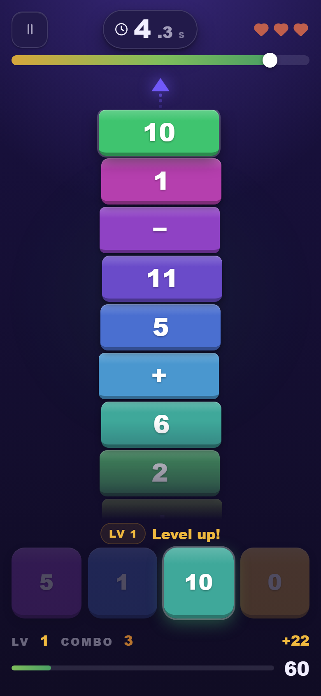

---

## 5. Таймер, очки, жизни

**Таймер на уравнение.** Времени даётся `(5.0 с + тир × 0.4 с) × давление` —
от 5.0 с на первом тире до 9.8 с на тринадцатом: сложные числа дольше читать. Часы
останавливаются в момент ответа, показ правильной коробки не съедает время
игрока.

**Давление.** Множитель падает на 1.4 % с каждого отвеченного вопроса до пола
0.30, а на последнем тире добавляется овертайм (см. раздел 4). Без него сильный игрок доходил до верхнего тира и выходил на плато, где
переставал ошибаться, — партия не заканчивалась никогда. Тир решает, насколько
сложны примеры, давление — сколько на них остаётся места.

| Событие | Последствие |
|---|---|
| Верный ответ | очки + рост тира |
| Неверный ответ | −1 ♥, комбо сброшено |
| Время вышло | −1 ♥, показывается правильный ответ |

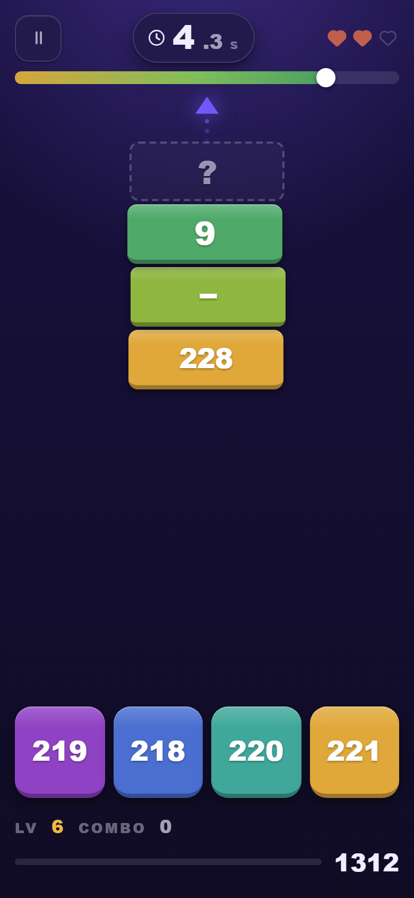

**Три жизни**, три сердца в шапке: целые, пока жизнь есть, и тот же контур
пустым, когда она потрачена. Форма не меняется, поэтому ряд не дёргается — о
потере сообщает только заливка.

Четвёртая жизнь была здесь какое-то время и делала партию мягче: у слабого игрока
доля партий короче 25 секунд падала с 32 % до 9 %, медиана росла с 31 до 40
секунд. Вернулись к трём по прямому решению — короткая, более резкая партия. Что
это стоит, видно в таблице ниже.

```
база       = 10 + тир × 6
бонус      = round(база × 0.8 × остаток_на_часах)
множитель  = 1 + min(комбо, 20) × 0.1        // до ×3.0
очки       = round((база + бонус) × множитель)
```

Скорость вознаграждается тем, что осталось на часах уравнения, — отдельного
бонуса времени больше нет.

> Почему так: раньше раунд имел общий таймер и бонус за скорость продлевал его.
> Замер показал, что часы шли на 40 % реальной скорости — «3 минуты» длились
> семь с половиной. Посекундный таймер убирает эту неопределённость целиком.

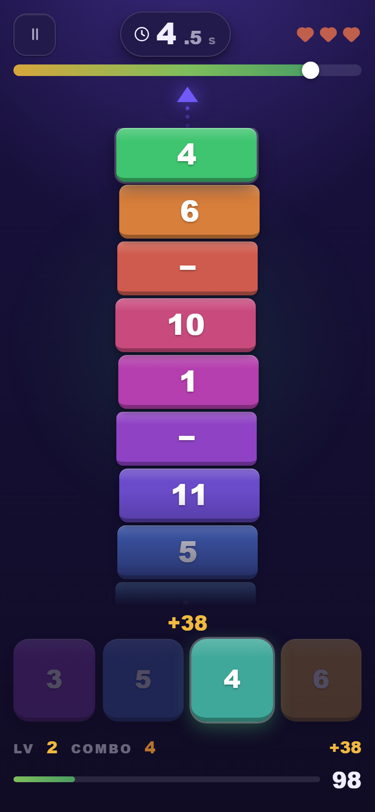

---

## 6. Обратная связь

Каждый ответ даёт четыре сигнала одновременно: цвет, форму, движение и звук.

- Верный: зелёная коробка взлетает по лучу и садится в гнездо, кнопка ответа
  заливается зелёным, появляется похвала, растёт полоса комбо. Награда `+N`
  всплывает над самой коробкой и уходит вверх — раньше она была прибита к
  верхнему краю сцены и упиралась в рамку уравнения, а слово «очков» повторяло
  то, что и так написано в счётной строке внизу.
- Неверный или просроченный: нажатая кнопка краснеет, **правильная всё равно
  подсвечивается зелёным**, и в гнездо прилетает зелёная коробка с верным
  числом — игра показывает, что там должно было стоять. Само гнездо зелёное в
  обоих случаях: в нём всегда стоит верный ответ, и красить его в красный
  значило бы пометить ошибкой правильное число. Гаснет один сегмент жизни.
- Пока ответа нет, на сцене стоит закрытая коробка с «?» — тот же силуэт, что и
  у прилетающего ответа, поэтому ничего не прыгает.
- Вибрация через `navigator.vibrate` (без нативного плагина), отключается в
  настройках.

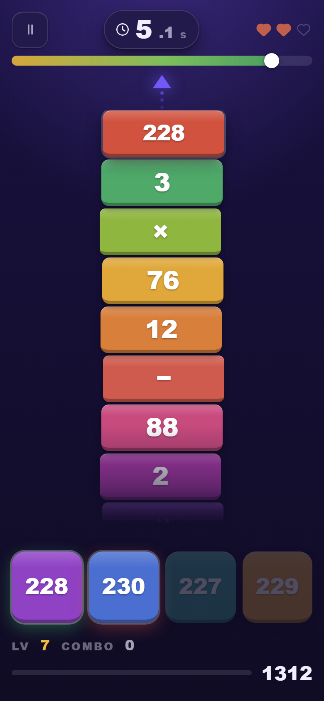

Уравнение набрано крупным шрифтом в отдельной панели, а форма коробки оставлена
только для ответа, который в неё прилетает, — поэтому прилёт читается как
событие. Цвет всей сцены и оператор подсвечены тоном текущей операции.

**Название операции с поля убрано.** Плашка «× УМНОЖЕНИЕ» под уравнением
дублировала то, что и так написано в самом уравнении, и забирала место у сцены.
Вместо неё запись стала однозначной сама по себе: степень пишется надстрочным
числом (`4²`, а не `4 ^ 2`), основание логарифма — подстрочным. Если спрятано
именно оно, гнездо ответа тоже уезжает вверх или вниз и сохраняет форму записи.

---

## 7. Мастерство, прогресс и рекорды

Партия длится минуту, и внутри неё всё одноразовое: счёт, серия, LV — исчезают
вместе с ней. Оставался один длинный итог — рекорд, одно число на режим. Играть
было зачем, а **достигать** нечего.

### Мастерство операций

У каждой из семи операций свой уровень 1–16 и своя полоска до следующего.
Уровень — это то, с какого тира стартует следующая партия по этой операции, то
есть достижение и есть навык, а не абстрактная награда рядом с ним.

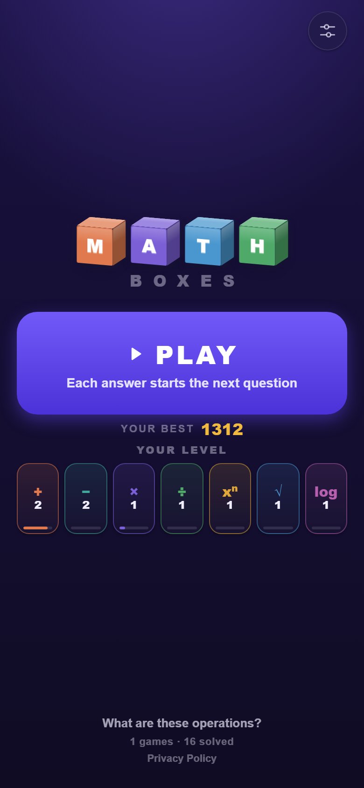

Полоса из семи значков стоит на главной **всегда**, а не только когда нужен
выбор: это единственное в игре, что переживает партию. В режиме «Одна» она же и
переключатель, а в остальных режимах тап по значку переводит в «Одну» с этой
операцией — «хочу подтянуть деление» стало одним нажатием.

**Начисление.** Каждый верный ответ капает в ту операцию, которую решали:

| Тир вопроса относительно своего уровня | Сколько стоит верный ответ |
|---|---|
| на своём уровне или выше | 1 |
| на 1–2 ниже | 0.35 |
| ещё ниже | 0 |

Иначе уровень 16 набивался бы однозначными примерами. Стоимость уровня растёт:
`4 + уровень` верных ответов, то есть с 1-го на 2-й — пять ответов, с 15-го на
16-й — девятнадцать.

**Замер роста** (120 партий на архетип, уровни `+ − × ÷ ^ √ log`):

| Партия | слабый | средний | сильный |
|---|---|---|---|
| 1 | 1/1/1/1/1/1/1 | 1/2/1/1/1/1/1 | 2/2/2/2/1/1/1 |
| 5 | 3/2/1/1/1/1/1 | 2/3/1/1/1/1/1 | 4/5/4/3/2/1/1 |
| 20 | 4/4/1/1/1/1/1 | 5/5/3/1/1/1/1 | 8/8/8/7/4/3/1 |
| 80 | 5/5/1/1/1/1/1 | 6/7/6/5/1/1/1 | 11/11/12/12/11/8/4 |

Первые партии дают уровень-два сразу — движение видно с первого раза. Дальше
замедляется: 16-й уровень по всем семи операциям не берётся и за 120 партий.

Слабый игрок остаётся на сложении и вычитании: остальные операции ему просто не
выпадают. Отсюда и вторая роль полосы — тап по значку даёт любую операцию
напрямую, без лестницы.

### В финале партии

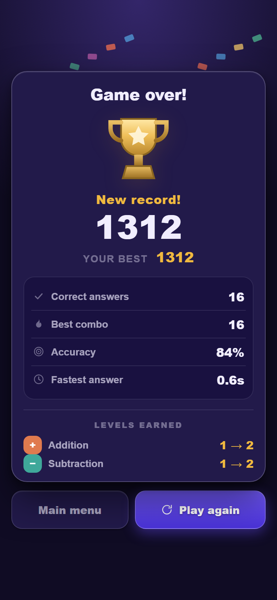

Под статистикой — блок «Новые уровни»: `+ Сложение 1 → 2`. Показываются только
операции, у которых уровень действительно вырос. Это единственная строка на
экране, которая не обнулится.

### Рекорды

| Механика | Детали |
|---|---|
| **Рекорд** | Один лучший счёт на слот (режим или операция). Виден на главной и в финале |
| **Мастерство** | Уровень и прогресс на каждую операцию, хранится в `profile.mastery` |

Профиль из версий до мастерства хранил пиковый тир на операцию — он становится
стартовым уровнем, поэтому обновление никого не понижает. Проверено: `skill`
`{+: 7, −: 5, ×: 3}` превращается в уровни `8 / 6 / 4`.

Отдельных экранов профиля, достижений и таблицы лидеров нет — по прямому
решению: в финале показываются результат партии, рекорд режима и заработанные
уровни, и этого достаточно.

Результат записывается **в момент окончания партии**, а не по нажатию кнопки:
закрытое приложение не должно стоить игроку забега.

---

## 8. Прочие экраны

<table>
<tr>
<td>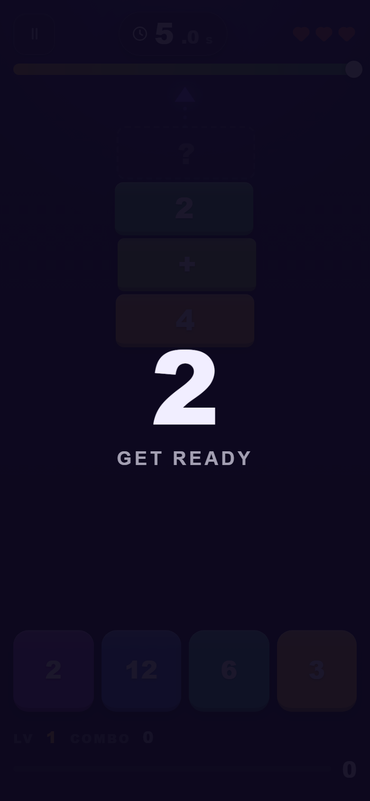<br><sub>Отсчёт</sub></td>
<td>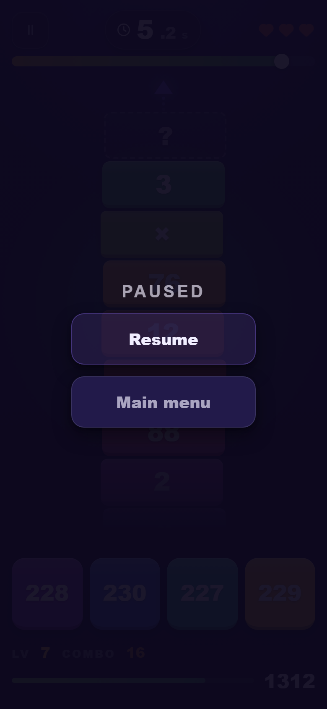<br><sub>Пауза</sub></td>
<td>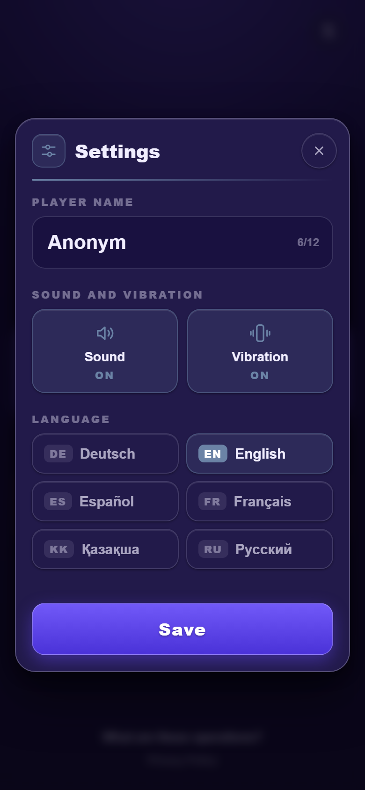<br><sub>Настройки</sub></td>
</tr>
</table>

- **Отсчёт** перед стартом — три доли по 480 мс, чтобы партия не началась
  раньше, чем игрок готов, и при этом не превращалась в ожидание.
- **Пауза** плюс автопауза по `visibilitychange`: звонок или сворачивание не
  сжигают таймер.
- **Настройки** (шестерёнка в шапке): имя, звук, вибрация, язык.

### Вёрстка без прокрутки

Игра мобильная, поэтому ни один экран не должен скроллиться. Все вертикальные
размеры — заголовки, кнопки, отступы — заданы через `clamp()` с привязкой к `vh`.
Проверено на 390×844 и на 360×640: переполнение 0 px на главной и на игровом
поле, в том числе с раскрытой полосой операций.

**Никаких абсолютных стопок.** Коробка и строка похвалы на игровом поле — это
ряды одной колонки. Раньше они позиционировались абсолютно друг относительно
друга и на сжатом экране накладывались. Коробка масштабируется от
реальной высоты сцены через `ResizeObserver`, а не по брейкпоинту.

---

## 9. Дизайн

**Тёмная тема.** База — почти чёрный индиго (`#100c24`), панели на тон светлее
(`#221a4a`), текст — `#f1eeff`, и один фиолетовый разлив сверху вместо
равномерной заливки. До этого база была бумажно-белой, и на ней башня проигрывала
странице по яркости: цветовая лента, которая и делает башню башней, работает
только против тёмного.

**Цвет в башне означает высоту, а не смысл.** Каждый блок берёт следующий тон
кольца — золото → лайм → зелень → бирюза → небо → синий → индиго → фиалка →
маджента → роза → красный → оранжевый и обратно к золоту. Соседние блоки поэтому
никогда не совпадают, и стопка читается как одна кладка с низом и верхом.
Операция отличается глифом, а не собственным цветом: попытка притушить её на
пару тонов дала ровно два грязных блока в середине.

Видимых рядов не больше десяти. На планшете помещалось четырнадцать, кольцо
замыкалось целиком, и вместо градиента выходила радуга.

**Один ясный тон на операцию.** Семь операций различимы и примерно одной
светлоты. Приглушённый набор до этого смешивался для бумаги; на тёмном он
превращался в семь оттенков грязи, а чипы мастерства на главной читались как
пустые дырки.

**Свечение — только там, где оно что-то значит.** За башней разгорается серия, у
стрелки над головой башни есть ореол, у кнопки основного действия — тоже. Больше
нигде: глубина строится на тени и светлой кромке сверху.

**Жизни — три сердца.** Какое-то время на их месте стояли нейтральные сегменты:
сердца казались самым «детским» элементом HUD. Вернулись к сердцам по прямому
решению — они читаются мгновенно и не требуют цифры рядом. Потраченная жизнь
остаётся тем же контуром, только без заливки.

**Кнопки ответов — тоже блоки.** Четыре тона той же ленты, тёмная полоса по низу
вместо тени и нажатие, которое сажает кнопку на эту полосу. Белые карточки на
тёмном выглядели вырезанными из другого экрана.

Коробки остались в логотипе и иконке — это айдентика игры и её название. Иконка,
экраны запуска и графика функции пересобираются одним скриптом
(`_docs/store/make-icons.mjs`) и стоят на той же тёмной базе: белая заставка
перед тёмной игрой мигала на весь экран.

Учтён `prefers-reduced-motion` — анимации отключаются.

---

## 10. Структура кода

```
src/
├─ utils/
│  ├─ mathEngine.ts     генератор задач, verify(), toCells(), chainStep()
│  ├─ progress.ts       мастерство: уровни, стоимость, начисление
│  ├─ color.ts          оттенки граней куба из одного hex
│  ├─ conts.ts          операции, режимы, ранги, награды, палитра
│  └─ types.ts
├─ composables/
│  ├─ useMathSession.ts сессия: таймер, счёт, комбо, адаптивный тир
│  └─ useAudio.ts       предзагрузка звуков, вибрация, сохранение настроек
├─ store/
│  ├─ gameStore.ts      выбор режима, рекорды, профиль, персист
│  └─ pageStore.ts
├─ pages/               StartPage, PlayGroundPage
└─ components/          CubeRube, AppIcon, ModalSheet, ResultTable,
                        SettingBlock, HelpSheet, LogoItem
```

### Хранение

Через `@capacitor/preferences`:

| Ключ | Содержимое |
|---|---|
| `name` | Имя игрока |
| `records3` | Лучший счёт на каждый слот |
| `profile` | Уровень по операциям, счётчики, дата задания дня |
| `lastSetup` | Последний режим и набор операций |
| `lang` | Выбранный язык |
| `soundEnabled`, `vibroEnabled` | Тумблеры |

Ключ `records3` — новый: формат партии менялся дважды, и прежние таблицы
оставлены нетронутыми, чтобы несравнимые результаты не смешивались.

---

## 11. Реклама

`src/utils/admob.ts`. Приложение под Families Policy, поэтому:

- `tagForChildDirectedTreatment`, `tagForUnderAgeOfConsent`, `maxAdContentRating: G`
  и `npa: true` выставлены всегда;
- ни один запрос не уходит до завершения `initialize()`;
- `immersiveMode` намеренно не включается — с Android 15 он уводит кнопку
  закрытия под навигационную панель;
- таймаут загрузки и watchdog: игра никогда не остаётся заблокированной за
  рекламой.

### Баннер — сверху и с зарезервированным местом

Баннер живёт только на игровом экране и стоит **сверху** (`TOP_CENTER`). Снизу он
приходился ровно на ряд ответов и строку счёта — на то, что игрок нажимает и
читает.

Нативный баннер рисуется *поверх* webview, и вёрстка о нём ничего не знает.
Поэтому `admob.ts` пишет его высоту в CSS-переменную `--ad-top`
(`document.documentElement`), а экраны превращают её в верхний отступ:

- игровой экран — `padding-top: calc(12px + var(--ad-top))`; `box-sizing:
  border-box` и `min-height: 100dvh` означают, что страница не вырастает — место
  отдаёт растягивающаяся середина, коробка становится меньше;
- финальный экран, пауза, отсчёт, модалки — тоже, потому что они `position:
  fixed` и отступ страницы на них не действует;
- у модалки ещё и `max-height: calc(88dvh - var(--ad-top))`: без этого высокий
  лист центрировался и уезжал под баннер.

До получения реальной высоты от SDK резервируется 56 px, при `SizeChanged`
значение уточняется, при снятии баннера сбрасывается в 0. В PWA-сборке
переменная не задаётся никогда, и все `calc()` дают исходные отступы.

Замер вёрстки при резерве 0 / 56 / 90 px на 390×844, 360×640 и 412×732: HUD
всегда начинается ниже баннера, строка счёта остаётся на экране, переполнения 0,
ряды не накладываются. Отдельно проверено, что карточка результата, пауза,
отсчёт и справочный лист не заходят под полосу 90 px.

### Межстраничная — раз в 3–4 партии

`src/store/adsStore.ts`. Партия длится около минуты, поэтому реклама после
каждой означала бы рекламу каждую минуту — самая громкая причина закрыть такую
игру. Счётчик партий с последней рекламы и случайный разрыв 3 или 4:

- разрыв случайный, а не фиксированный, чтобы реклама не приходилась на
  предсказуемую партию, которую можно научиться обрывать;
- счётчик хранится в `Preferences` (`adGate`), поэтому выход из приложения между
  партиями не способ никогда её не увидеть;
- прежний ограничитель «не чаще одной в 90 с» остался как страховка.

Замер правила на 300 000 партий: одна реклама на 3.50 партии, разрывы ровно 3 и
4 в пропорции 50/50, минимум 3, максимум 4.

---

## 12. Вес и производительность

Замер вместо ощущений.

**Вес веб-части: 4828 KB → 692 KB.** Это ровно то, что Capacitor кладёт в APK
(`webDir: 'docs'`), так что столько же ушло и из приложения.

| Что | Было | Стало | Почему |
|---|---|---|---|
| Шрифты `.ttf` | 1406 KB | 0 | Ни один не загружался — см. ниже |
| Скриншоты для установки | 1552 KB | 140 KB | PNG → WebP |
| Иконки | 1240 KB | 172 KB | `icon-512.webp` весил 345 KB при размере 512×512 |
| `logo.png` | 184 KB | 16 KB | Файл в `public/`, который приложение не рисует |
| JS + CSS | 249 KB | 249 KB | Не трогали |

**Девять шрифтов, которые никогда не грузились.** В каждом `@font-face` стояло
`font-family: 'SofiaSans', sans-serif` — список шрифтов там недопустим, поэтому
браузер отбрасывал все девять правил: `document.fonts.size === 0`, в сети ни
одного запроса на `.ttf`. Игра всё это время рисовалась системным `sans-serif`, а
1.4 MB начертаний лежали в APK мёртвым грузом. Замена объявления на
`font-family: sans-serif` ничего не меняет визуально по определению —
незарегистрированное семейство и так проваливалось на следующее в списке.

**Предзагрузка service worker: 2226 KB → 266 KB.** `globPatterns` захватывал все
PNG, то есть воркер тянул скриншоты витрины и полный набор иконок до первой
партии. Теперь `globIgnores` исключает `screenshots/**` и `icons/**` — их берут
браузер и система, когда они действительно нужны.

Заодно вычищено то, что нашлось по пути: мёртвый импорт CSS
`@limonische/vue3-transition-expand` (компонент нигде не используется), пять
`mstile-*` (плитки Windows 8, причём их записи объявляли размеры, которых у
файлов не было: `558x270` у картинки 150×150), две записи манифеста на
несуществующие `narrow-6` / `wide-6`, и объявленный тип `image/png` у файлов
`.webp`. Манифест проверен: битых ссылок нет.

**Скорость.** Замер частоты кадров в игре при троттлинге процессора ×1, ×4 и ×8:

| CPU | Загрузка | Кадр (медиана) | p95 | Пропущенных из 180 |
|---|---|---|---|---|
| ×1 | 411 мс | 16.7 мс | 18.1 мс | 0 |
| ×4 | 604 мс | 16.7 мс | 19.5 мс | 0 |
| ×8 | 983 мс | 18.1 мс | 28.1 мс | 5 |

То есть 60 fps держатся даже на восьмикратно замедленном процессоре. Убран
`backdrop-filter: blur(4px)` с оверлея отсчёта: подложка и так на 97 %
непрозрачная, размытие было не видно, но GPU фильтровал весь экран — и именно
этот оверлей появляется в начале каждой партии.

Что осталось непроверенным: троттлинг эмулирует слабый процессор, но не слабый
GPU. `filter: drop-shadow` на летящей коробке и `backdrop-filter` в модалках на
дешёвом устройстве могут стоить дороже, чем здесь; если на реальном телефоне
будет заметно, это следующие кандидаты.

---

## 13. Как проверялось

| Проверка | Результат |
|---|---|
| Генератор | 280 000 задач: валидность, единственный верный вариант, границы |
| Сессия | Симуляции игроков 100/85/60/30 %, потолок времени, защита от ответа на паузе |
| Локализация | 122 ключа × 6 языков, пропусков нет |
| Типы | Строгий `tsc` по всему не-`.vue` коду |
| Экраны | Headless-прогон 390×844: 0 ошибок консоли, 0 горизонтальных переполнений |

`vue-tsc` в проекте сломан (несовместим с установленным TypeScript) — это
известная проблема репозитория, не связанная с этими изменениями.

---

## 14. Идеи на будущее

- Разбор ошибок после партии: показать 3–5 задач, где игрок ошибся.
- Недельная таблица по заданию дня.
- Режим без таймера для самых младших.
- Двойные очки за просмотр рекламы (rewarded) — сейчас подключены только баннер
  и межстраничная.
